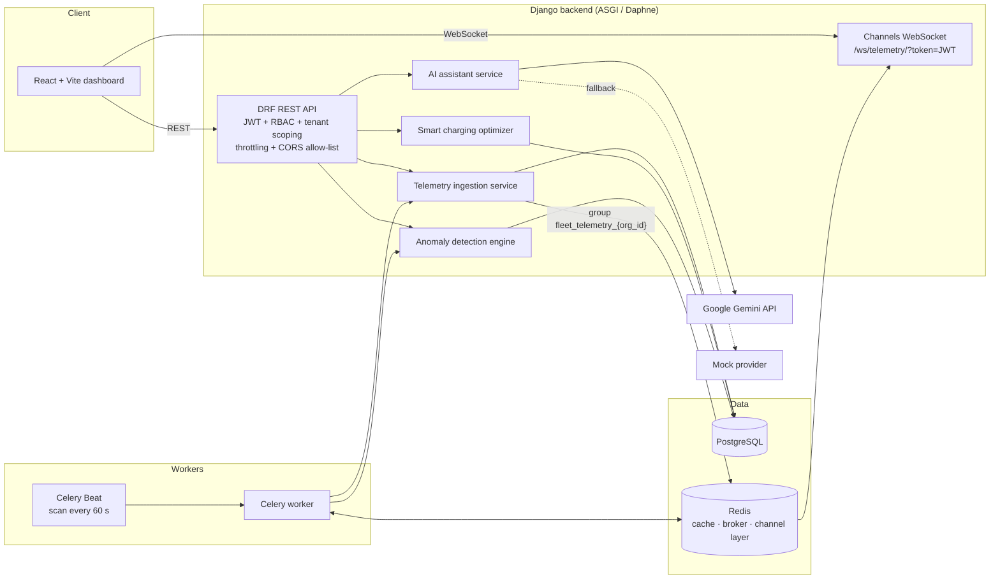

# ⚡ VoltFleet — EV Fleet Intelligence & Smart Charging Platform

A multi-tenant backend and dashboard for operating electric-vehicle fleets. VoltFleet ingests vehicle telemetry, detects battery and data-quality anomalies, schedules charging around time-of-use electricity tariffs, streams live positions to a map, and lets operators ask questions about their fleet in plain English through an AI assistant.


---

## Table of Contents

1. [Why this project](#why-this-project)
2. [Features](#features)
3. [Architecture](#architecture)
4. [Tech stack](#tech-stack)
5. [Data model](#data-model)
6. [How the core engines work](#how-the-core-engines-work)
7. [Security & multi-tenancy](#security--multi-tenancy)
8. [API reference](#api-reference)
9. [Getting started](#getting-started)
10. [Configuration](#configuration)
11. [Running tests](#running-tests)
12. [Project structure](#project-structure)
13. [Known limitations & roadmap](#known-limitations--roadmap)
14. [Author](#author)

---

## Why this project

Fleet operators running electric vans and trucks face three recurring problems:

- **Visibility** — where is each vehicle, what is its battery state, and is its data still arriving?
- **Safety & reliability** — which vehicles show dangerous battery temperatures or abnormal energy loss?
- **Cost** — how do you charge every vehicle before its departure deadline while paying the least for electricity?

VoltFleet addresses all three in one platform, with strict per-organization data isolation so several companies can share a single deployment.

---

## Features

### 🏢 Multi-tenant access control
- Custom email-based `User` model with **JWT authentication** (SimpleJWT: 60-minute access tokens, 7-day refresh tokens).
- `Organization` → `Membership` structure with four roles: **Platform Admin, Org Admin, Fleet Operator, Analyst**.
- Reusable `TenantScopedQuerysetMixin` that restricts querysets to the caller's organization; telemetry history is scoped through `vehicle__organization`.
- A single helper, `get_active_user_organization()`, resolves a user's organization from their memberships and is shared by the REST views and the WebSocket consumer.
- Role-based DRF permission classes (`IsPlatformAdmin`, `IsOrgAdmin`, `IsFleetOperator`).
- `AuditLog` model for security-relevant actions.
- Dedicated **tenant-isolation tests** proving one organization cannot read or write another's telemetry.

### 🚗 Fleet & vehicle management
- Fleets (depots), a global OEM **vehicle specification catalog** (battery capacity, AC/DC charge limits, rated efficiency) and vehicles with live state.
- Per-vehicle **departure deadline and target state-of-charge**, which drive the charging optimizer.
- Computed **estimated range** from SOC, battery size and efficiency.
- Search, ordering and pagination on all list endpoints.

### 📡 Telemetry ingestion
- Single-event and **batch ingestion**; the batch endpoint accepts either a JSON array or `{"events": [...]}` and rejects requests of more than **1,000 events** with `400`.
- **Tolerant of partial payloads**: temperature, GPS, speed, power, odometer and energy are optional; missing values are stored as `NULL` or zero instead of failing the request.
- **Strict range validation**: SOC must be 0–100 %, battery temperature −40 to 120 °C, latitude ±90, longitude ±180, and speed, odometer and energy cannot be negative; invalid events return `400`.
- **Duplicate-safe**: duplicates are removed inside a batch, checked against existing rows, and backed by a `UNIQUE(vehicle, timestamp)` database constraint. The response reports `accepted` and `ignored_duplicates`.
- **Cross-tenant spoofing is rejected**: readings for vehicles outside the caller's organization are silently dropped.
- Inside one transaction the vehicle's live state is reconciled with its newest reading: SOC, odometer (never decreases) and status (`IN_TRANSIT` when moving).
- Optional **asynchronous ingestion through Celery** with retry and back-off.
- **Real-time WebSocket broadcast** of every newly stored reading to the vehicle's own organization only (Django Channels + Redis).
- Management command to **simulate driving and charging cycles** for demos.

### 📊 Analytics
- Fleet summary: active vehicles, status breakdown, distance travelled, energy consumed, average efficiency (kWh/100 km) and average SOC, with optional time-window filtering.
- Per-vehicle efficiency analytics.

### 🔋 Smart charging optimizer
- Deterministic **earliest-deadline-first, time-of-use-aware scheduler** (see [below](#smart-charging-optimizer)).
- Persists each run as a `ChargingPlan` with per-vehicle `ChargingPlanItem`s, total energy and estimated cost.
- Reports vehicles that could **not** be scheduled and why.

### 🚨 Anomaly detection
- Rule-based engine that scans each organization for battery over-temperature, suspicious SOC drops and silent vehicles.
- **Cool-down de-duplication** so a continuing condition does not spam alerts.
- Workflow: `OPEN → ACKNOWLEDGED → RESOLVED / FALSE_POSITIVE`, with a resolution log.
- Runs on demand (`POST /anomalies/scan/`) and **automatically every 60 seconds** through a Celery Beat schedule.

### 🤖 AI assistant (provider-based)
- Natural-language fleet Q&A, **anomaly explanations** and **charging-plan explanations**.
- Provider abstraction (`BaseAIProvider`) with a **Google Gemini** implementation and a **mock provider** so the app works with no API key.
- Answers are grounded in a JSON snapshot of the organization's own data; the prompt instructs the model not to invent figures.
- Anomaly explanations are validated against a **Pydantic schema** before being returned.
- Chat is **rate-limited** (15 requests/minute per user) and error responses never expose internal exception text.

### 🖥️ React dashboard
- **Operator login screen** with JWT session handling: the token is stored in the browser, attached to every request, and an expired session (`401`) signs the user out automatically. A **Sign Out** control is in the header.
- Tabs for Overview, Vehicles, Charging, Anomalies, AI Chat and a Leaflet **live fleet map**.
- The live map connects to the **tenant-scoped WebSocket** using the user's JWT; the header shows the connection state.
- If the backend is unreachable, a banner warns that a local simulated demo dataset is being shown.
- Built with React 19, Vite and Tailwind CSS.

### 📚 Developer experience
- Auto-generated **OpenAPI schema and Swagger UI** (drf-spectacular).
- Health-check endpoint, Docker Compose for Postgres and Redis, and a `seed_fleet_demo` command for realistic sample data.

---

## Architecture



**Request flow for telemetry:** device → `POST /telemetry/ingest/batch/` → validation → de-duplication (batch + database) → tenant check → bulk insert → vehicle state reconciliation → broadcast to the organization's WebSocket group → dashboard map updates. Anomaly scans read the stored telemetry on a schedule.

---

## Tech stack

| Layer | Technology |
|---|---|
| Language | Python 3.12+ |
| Web framework | Django 5.x, Django REST Framework |
| Auth | SimpleJWT, custom user model, role-based permissions |
| Database | PostgreSQL 16 (UUID primary keys, composite indexes) |
| Cache / broker / pub-sub | Redis 7 |
| Async jobs | Celery 5 + django-celery-beat |
| Real-time | Django Channels, channels-redis, Daphne |
| AI | Google Gemini (`google-genai`), Pydantic validation, mock fallback |
| API docs | drf-spectacular (OpenAPI 3 / Swagger UI) |
| Frontend | React 19, Vite, Tailwind CSS, Leaflet / react-leaflet, lucide-react |
| Testing & linting | pytest, pytest-django, pytest-asyncio, Ruff, oxlint |
| Infrastructure | Docker Compose (Postgres + Redis) |

---

## Data model

| Model | Purpose |
|---|---|
| `Organization` | Tenant boundary |
| `User`, `Membership` | Email login; user ↔ organization with a role |
| `AuditLog` | Who did what, where, from which IP |
| `Fleet` | Depot-level grouping of vehicles |
| `VehicleSpecification` | OEM catalog: capacity, AC/DC limits, efficiency |
| `Vehicle` | Live SOC, odometer, status, departure deadline and target SOC |
| `TelemetryRecord` | Time-series reading; unique per `(vehicle, timestamp)`; tenant reached through its vehicle |
| `ChargingStation`, `Charger` | Depot infrastructure (AC Level 2 / DC fast), power and efficiency |
| `TariffPeriod` | Time-of-use price windows (supports windows that cross midnight) |
| `ChargingSession` | Actual charging sessions |
| `ChargingPlan`, `ChargingPlanItem` | Output of an optimizer run |
| `Anomaly`, `AnomalyResolutionLog` | Detected issues and their lifecycle |

---

## How the core engines work

### Smart charging optimizer

`apps/optimizer/engine.py` — `SmartChargingOptimizer`

1. **Select candidates** — active vehicles that are `AVAILABLE` or `CHARGING`, and chargers that are `AVAILABLE` or `OCCUPIED`, all within the caller's organization.
2. **Prioritise** — sort vehicles by departure deadline (earliest first), then by lowest current SOC.
3. **Size the job** — `required kWh = capacity × (target SOC − current SOC) / 100`.
4. **Evaluate every charger** — effective power is `min(charger kW, vehicle max kW)`; duration is `energy / (power × charger efficiency)`, rounded **up** to 15-minute slots.
5. **Slide a window** across the horizon in 15-minute steps, skipping windows that collide with an existing reservation on that charger.
6. **Price each window** against the active tariff periods (evaluated at the window midpoint, with overnight periods handled) and keep the cheapest feasible window.
7. **Reserve** the winning slot and continue; vehicles with no feasible slot are returned in `unmet_vehicles`.

It is a greedy heuristic, not a global optimum — fast, explainable and deterministic, which is why the AI assistant can describe its decisions faithfully.

### Anomaly detection

`apps/anomalies/detector.py` — `AnomalyDetectionEngine`

| Rule | Condition | Severity |
|---|---|---|
| `HIGH_BATTERY_TEMP` | latest pack temperature > 45 °C | Critical |
| `SUDDEN_SOC_DROP` | SOC falls > 5 % within ≤ 10 min while moving < 2 km | High |
| `STALE_TELEMETRY` | no reading for > 120 min | Medium |

Each rule stores the observed value, threshold, a human-readable evidence summary and context JSON. A 60-minute cool-down prevents duplicate open incidents for the same vehicle and type. Celery Beat triggers `run_scheduled_anomaly_scans` every 60 seconds for all active organizations.

### AI assistant

`apps/ai_assistant/`

- `get_provider()` returns the Gemini provider when `GEMINI_API_KEY` is set, otherwise the mock provider.
- For chat, the service builds a context object (fleet summary, unresolved anomalies, latest charging plan) and sends it with the question. This is **context-grounded generation**, not autonomous tool-calling.
- Anomaly explanations are requested as JSON and validated by `AnomalyExplanationSchema` (summary, hypotheses, recommended actions, confidence 0–1, evidence grounding).

---

## Security & multi-tenancy

| Concern | How it is handled |
|---|---|
| Authentication | JWT bearer tokens; 60-minute access lifetime; no hardcoded credentials in the frontend |
| Authorization | Role-based permission classes plus tenant-scoped querysets |
| Cross-tenant writes | Ingestion only accepts vehicles belonging to the caller's organization |
| Cross-tenant reads | Telemetry history, AI context, anomaly and plan lookups are filtered by organization |
| Real-time isolation | WebSocket connections require a valid JWT and join only `fleet_telemetry_{org_id}` |
| Input validation | Range checks on SOC, temperature, GPS, speed, odometer and energy at the API boundary |
| Safe defaults | `DJANGO_DEBUG` defaults to `False`; set it to `True` explicitly for local development |
| CORS | Explicit allow-list from `CORS_ALLOWED_ORIGINS` (no wildcard) |
| Abuse protection | DRF throttling: 100/min anonymous, 1000/min authenticated, 15/min for AI chat |
| Error hygiene | AI endpoints return generic messages and log details server-side |
| Secrets | `.env` is git-ignored; only `.env.example` is committed |

---

## API reference

Base path: `/api/v1/` — interactive docs at **`/api/v1/docs/`**, schema at `/api/v1/schema/`.

| Area | Method & path | Description |
|---|---|---|
| Health | `GET /health/` | Service status |
| Auth | `POST /auth/register/` | Create user and organization |
| | `POST /auth/token/` | Obtain JWT pair |
| | `POST /auth/token/refresh/` | Refresh access token |
| | `GET /auth/profile/` | Current user and roles |
| Fleet | `/fleets/`, `/vehicles/`, `/specifications/` | CRUD (specifications read-only), search and ordering |
| Telemetry | `POST /telemetry/ingest/` | Ingest one reading |
| | `POST /telemetry/ingest/batch/` | Ingest up to 1,000 readings (array or `{"events": [...]}`) |
| | `GET /telemetry/history/` | Tenant-scoped history; filter by `vehicle_id`, `start_time`, `end_time` |
| Analytics | `GET /analytics/summary/` | Fleet KPIs (optional `start_time`, `end_time`) |
| | `GET /analytics/vehicles/{id}/` | Per-vehicle efficiency |
| Charging | `/charging/stations/`, `/chargers/`, `/tariffs/`, `/sessions/` | Infrastructure, tariffs, sessions |
| Optimizer | `POST /optimizer/plans/generate/` | Run the scheduler for a time window (`horizon_start`, `horizon_end`) and store a plan |
| | `GET /optimizer/plans/` | List and inspect plans |
| Anomalies | `GET /anomalies/` | Filter by `status`, `severity`, `vehicle_id` |
| | `POST /anomalies/scan/` | Run a detection scan |
| | `POST /anomalies/{id}/acknowledge/` · `/resolve/` | Lifecycle actions |
| AI | `POST /ai/chat/` | Ask a question about the fleet (rate-limited) |
| | `GET /ai/anomalies/{id}/explain/` | Structured explanation |
| | `GET /ai/plans/{id}/explain/` | Plain-language plan summary |
| WebSocket | `ws://<host>/ws/telemetry/?token=<ACCESS_TOKEN>` | Live telemetry for your organization |

### Example: ingest a batch

```bash
curl -X POST http://127.0.0.1:8000/api/v1/telemetry/ingest/batch/ \
  -H "Authorization: Bearer <ACCESS_TOKEN>" \
  -H "Content-Type: application/json" \
  -d '{
    "events": [{
      "vehicle_id": "<VEHICLE_UUID>",
      "timestamp": "2026-10-19T08:30:00Z",
      "soc_percent": "72.50",
      "battery_temperature_celsius": "31.2",
      "power_kw": "-18.40",
      "cumulative_energy_kwh": "412.300",
      "speed_kmh": "46.00",
      "odometer_km": "14250.80",
      "latitude": "12.971600",
      "longitude": "77.594600"
    }]
  }'
```

`power_kw` is **positive when charging** and **negative when driving**. Only `vehicle_id`, `timestamp` and `soc_percent` are required.

### Example: generate a charging plan

```bash
curl -X POST http://127.0.0.1:8000/api/v1/optimizer/plans/generate/ \
  -H "Authorization: Bearer <ACCESS_TOKEN>" \
  -H "Content-Type: application/json" \
  -d '{
    "title": "Overnight charging",
    "horizon_start": "2026-10-20T18:00:00Z",
    "horizon_end": "2026-10-21T06:00:00Z"
  }'
```

`vehicle_ids` and `charger_ids` are optional filters; `horizon_end` must be after `horizon_start`. The response lists scheduled vehicles, total energy, estimated cost and any vehicles that could not be scheduled.

### Example: listen to live telemetry

```js
const ws = new WebSocket(`ws://127.0.0.1:8000/ws/telemetry/?token=${accessToken}`);
ws.onmessage = (e) => console.log(JSON.parse(e.data)); // { vehicle_plate, soc_percent, latitude, ... }
```

Connections without a valid token are closed with code `4401`.

---

## Getting started

### Prerequisites
- Python 3.12+
- Node.js 20+
- Docker and Docker Compose (for PostgreSQL and Redis)

### 1. Clone

```bash
git clone https://github.com/ShashankSingh2020/VoltFleet.git
cd VoltFleet
```

### 2. Start PostgreSQL and Redis

```bash
docker compose up -d
```

This exposes Postgres on host port **5435** and Redis on host port **6380**.

### 3. Configure environment

```bash
cp .env.example .env
```

`.env.example` uses the native ports (Postgres `5432`, Redis `6379`). If you use the bundled Docker Compose file, change them to **5435** and **6380**. Never commit `.env`.

### 4. Backend

```bash
python -m venv .venv
source .venv/bin/activate          # Windows: .venv\Scripts\activate
pip install -r backend/requirements.txt

cd backend
python manage.py migrate
python manage.py seed_fleet_demo   # demo organizations, vehicles, tariffs, telemetry
python manage.py runserver         # Daphne serves ASGI + WebSockets
```

Open **http://127.0.0.1:8000/api/v1/docs/** for Swagger.

### 5. Background workers

```bash
cd backend
celery -A voltfleet worker -l info
celery -A voltfleet beat -l info   # runs the 60-second anomaly scan
```

### 6. Frontend

```bash
cd frontend
npm install
npm run dev                        # http://localhost:5173
```

### 7. Generate live data

```bash
cd backend
python manage.py simulate_telemetry --steps 30 --interval-minutes 5
```

### Demo login

`seed_fleet_demo` creates a demo organization admin, `admin@voltfleet.io`. Sign in through the dashboard's login screen (it has a **Fill Demo Credentials** shortcut for local use). The demo password is defined in the seed command for local demos only — **change it before any non-local deployment**.

---

## Configuration

| Variable | Description | Example |
|---|---|---|
| `DJANGO_SECRET_KEY` | Django secret — generate a strong value | *(random 50+ chars)* |
| `DJANGO_DEBUG` | Debug mode (defaults to `False`) | `True` locally, `False` in production |
| `DJANGO_ALLOWED_HOSTS` | Comma-separated hosts | `localhost,127.0.0.1` |
| `DATABASE_URL` | Full PostgreSQL URL (takes priority) | `postgres://postgres:<password>@localhost:5435/voltfleet` |
| `DB_NAME` `DB_USER` `DB_PASSWORD` `DB_HOST` `DB_PORT` | Used only if `DATABASE_URL` is not set | `voltfleet`, `postgres`, …, `localhost`, `5435` |
| `REDIS_URL` | Redis **base URL without a database number**; the app uses `/1` for the cache and `/2` for Channels | `redis://localhost:6380` |
| `CELERY_BROKER_URL` | Celery broker | `redis://localhost:6380/0` |
| `CELERY_RESULT_BACKEND` | Celery results | `redis://localhost:6380/0` |
| `CORS_ALLOWED_ORIGINS` | Comma-separated frontend origins | `http://localhost:5173,http://127.0.0.1:5173` |
| `GEMINI_API_KEY` | Optional; leave blank to use the mock AI provider | — |
| `GEMINI_MODEL_NAME` | Gemini model | `gemini-2.5-flash` |

---

## Running tests

Redis must be running (`docker compose up -d`), because API throttling uses the Redis cache.

```bash
cd backend
pytest                       # whole suite (27 tests)
pytest apps/telemetry        # one app, including tenant-isolation tests
ruff check .                 # lint
```

The suite covers authentication, vehicles, telemetry ingestion and Celery tasks, **tenant isolation**, analytics, the charging optimizer, anomaly detection and the AI assistant (using the mock provider).

---

## Project structure

```
VoltFleet/
├── backend/
│   ├── manage.py
│   ├── pytest.ini
│   ├── requirements.txt
│   ├── voltfleet/                 # settings, urls, asgi, celery (+ beat schedule)
│   └── apps/
│       ├── authentication/        # users, organizations, roles, audit log
│       ├── vehicles/              # fleets, specs, vehicles, seed command
│       ├── telemetry/             # ingestion service, WebSocket consumer, Celery tasks, simulator
│       ├── analytics/             # fleet and vehicle KPIs
│       ├── charging/              # stations, chargers, tariffs, sessions
│       ├── optimizer/             # smart charging engine + plans
│       ├── anomalies/             # detection engine, lifecycle, scheduled scans
│       └── ai_assistant/          # providers (Gemini / mock), schemas, context tools
├── frontend/
│   └── src/
│       ├── components/            # dashboard, vehicles, charging, anomalies, ai, map
│       └── services/api.js
├── docker-compose.yml
└── .env.example
```

---

## Known limitations & roadmap

Being upfront about scope:

- [ ] The frontend stores the access token in `localStorage` and has no refresh-token flow, so users must sign in again after 60 minutes. Moving to refresh tokens (or `httpOnly` cookies) is planned.
- [ ] The login screen shows demo credentials for local convenience; hide them outside development builds (for example behind `import.meta.env.DEV`).
- [ ] Anomaly rules are threshold-based; `HIGH_CONSUMPTION` is defined but not yet detected. Statistical or ML-based detection is a natural next step.
- [ ] The optimizer is a greedy heuristic. A MILP/CP-SAT formulation would give globally optimal schedules and support grid power limits.
- [ ] Add CI (GitHub Actions: lint + tests) and production Dockerfiles for a fully containerised stack.
- [ ] Add screenshots and a short demo GIF to `docs/`.

---

## Author

**Shashank Pratap Singh** — BTech Electronics & Communication Engineering, Bangalore Institute of Technology.

[GitHub](https://github.com/ShashankSingh2020) · [LinkedIn](https://linkedin.com/in/shashank-pratap-singh-530437303) · [LeetCode](https://leetcode.com/u/Shashank_pratap_singh) · singh2020shashank@gmail.com
