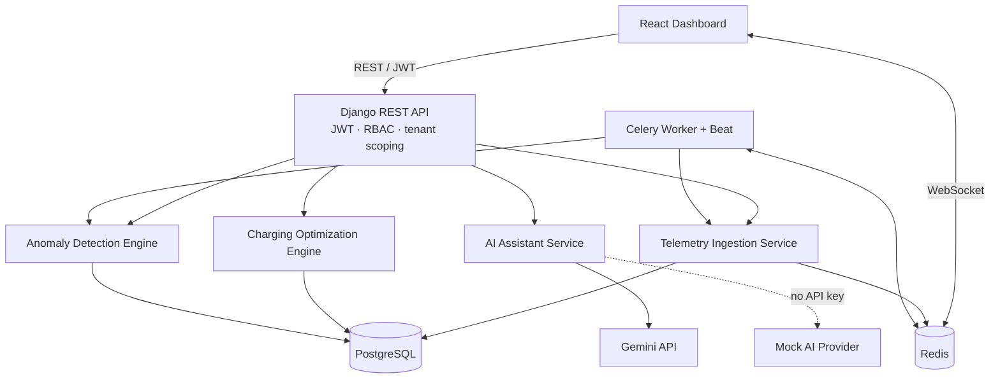

<div align="center">

# ⚡ VoltFleet
### EV Fleet Intelligence & Smart Charging Platform

**A multi-tenant platform for fleet telemetry, battery anomaly detection, charging-cost optimization, and AI-assisted fleet operations.**


[Features](#-key-features) · [Architecture](#-architecture) · [API](#-api-overview) · [Run Locally](#-run-locally) · [Tests](#-testing)

</div>

---

## 🚀 Overview

VoltFleet is a full-stack EV fleet operations project designed around a practical question:

> **How can a fleet operator monitor vehicle health, identify suspicious telemetry, and schedule charging at a lower estimated electricity cost—without mixing data between organizations?**

The platform combines a Django REST API, PostgreSQL, Redis-backed background processing, real-time telemetry updates, a deterministic charging scheduler, and an optional Gemini-powered assistant. A React dashboard brings the main workflows together.

It is built as a **portfolio and learning project**. Telemetry is simulated, the charging engine is a heuristic rather than a mathematical global optimizer, and the AI assistant is an explanatory layer—not an autonomous control system.

## ✨ Key Features

### 🏢 Multi-tenant identity and access
- Email-based custom user model with JWT access/refresh tokens.
- Organization memberships and role-aware permissions.
- Organization-scoped API querysets for fleet data.
- Audit-log model for recording security-relevant actions.

### 🚙 Fleet and vehicle management
- Manage fleets, vehicles, depots, chargers, and vehicle specifications.
- Track battery state of charge (SOC), odometer, vehicle status, and departure targets.
- Estimate remaining driving range from SOC, usable battery capacity, and rated efficiency.
- Search, ordering, and paginated list endpoints.

### 📡 Telemetry ingestion and live updates
- Single-event and batch ingestion endpoints.
- Request-level duplicate filtering and a database uniqueness constraint on `(vehicle, timestamp)`.
- Reconcile vehicle state from accepted readings.
- Optional Celery processing for background ingestion.
- Django Channels / Redis WebSocket events for dashboard updates.
- Management commands for generating realistic demo fleet activity.

### 📊 Fleet analytics
- Fleet size and status breakdown.
- Distance, energy, efficiency, and average-SOC summaries.
- Optional time-window filtering and per-vehicle analytics.

### 🔋 Smart charging planner
- Prioritizes vehicles by departure deadline and current SOC.
- Calculates energy required to reach each target SOC.
- Evaluates compatible chargers and 15-minute schedule slots.
- Estimates charging cost from time-of-use tariff periods, including overnight windows.
- Stores plans and reports vehicles that could not be scheduled.

**Algorithm note:** the scheduler is a deterministic greedy heuristic. It is explainable and useful for a portfolio demo, but it does not guarantee a globally optimal schedule or model every real-world grid constraint.

### 🚨 Rule-based anomaly detection
- **High battery temperature:** above 45 °C.
- **Sudden SOC drop:** more than 5 percentage points over a short interval with little odometer movement.
- **Stale telemetry:** no recent reading for more than 120 minutes.
- Anomaly lifecycle: open, acknowledged, resolved, or marked false positive.
- Cooldown-based suppression of repeated alerts for an ongoing condition.

These are configurable demo thresholds, not a substitute for OEM battery safety logic.

### 🤖 AI fleet assistant
- Ask natural-language questions about the fleet snapshot.
- Request explanations of anomalies and charging plans.
- Gemini provider with schema validation for structured anomaly explanations.
- Mock provider fallback when no API key is configured.

The assistant uses prepared fleet context; it should be described as **context-grounded AI assistance**, not a fully autonomous agent.

### 🖥️ React dashboard and API documentation
- React 19 + Vite dashboard.
- Overview, vehicles, charging, anomalies, AI chat, and map-oriented telemetry views.
- OpenAPI schema and Swagger UI generated by `drf-spectacular`.

---

## 🧱 Technology Stack

| Area | Technologies |
|---|---|
| Backend | Python, Django, Django REST Framework |
| Authentication | SimpleJWT, custom user model, role-based permissions |
| Data | PostgreSQL, Django ORM, UUID identifiers |
| Async work | Celery, django-celery-beat |
| Cache / broker / realtime | Redis, Django Channels, channels-redis |
| AI | Google Gemini (`google-genai`), Pydantic, mock provider |
| Frontend | React, Vite, Tailwind CSS, Leaflet |
| API documentation | OpenAPI, drf-spectacular / Swagger UI |
| Quality | pytest, pytest-django, Ruff, oxlint |
| Local infrastructure | Docker Compose for PostgreSQL and Redis |

## 🏛️ Architecture



### Main data entities

| Entity | Responsibility |
|---|---|
| `Organization`, `Membership`, `User` | Tenant boundaries, identity, and roles |
| `Fleet`, `Vehicle`, `VehicleSpecification` | Fleet inventory and vehicle capabilities |
| `TelemetryRecord` | Timestamped SOC, temperature, power, energy, location, and odometer readings |
| `ChargingStation`, `Charger`, `TariffPeriod` | Charging infrastructure and electricity pricing |
| `ChargingPlan`, `ChargingPlanItem` | Optimizer output and per-vehicle allocations |
| `Anomaly`, `AnomalyResolutionLog` | Detected conditions and their lifecycle |
| `AuditLog` | Security-relevant action history |

---

## 🔌 API Overview

Base URL: `http://127.0.0.1:8000/api/v1/`

After starting the backend, open **[Swagger UI](http://127.0.0.1:8000/api/v1/docs/)** to inspect request schemas and try endpoints.

| Area | Endpoint | Purpose |
|---|---|---|
| Health | `GET /health/` | Service health check |
| Authentication | `POST /auth/register/` | Register a user and organization |
| Authentication | `POST /auth/token/` | Obtain JWT tokens |
| Authentication | `POST /auth/token/refresh/` | Refresh an access token |
| Profile | `GET /auth/profile/` | View authenticated user profile |
| Fleet | `/fleets/`, `/vehicles/`, `/specifications/` | Manage fleet inventory; specifications are read-only |
| Telemetry | `POST /telemetry/ingest/` | Ingest one reading |
| Telemetry | `POST /telemetry/ingest/batch/` | Ingest a batch of readings |
| Telemetry | `GET /telemetry/history/` | Retrieve accessible telemetry history |
| Analytics | `/analytics/summary/` | Fleet-level metrics |
| Charging | `/charging/stations/`, `/chargers/`, `/tariffs/`, `/sessions/` | Charging infrastructure and sessions |
| Optimization | `POST /optimizer/plans/generate/` | Generate and persist a charging plan |
| Anomalies | `POST /anomalies/scan/` | Scan for configured anomaly rules |
| AI | `POST /ai/chat/` | Ask a fleet-context question |
| WebSocket | `/ws/telemetry/` | Live telemetry events (see security note below) |

All protected REST endpoints require:

```http
Authorization: Bearer <ACCESS_TOKEN>
```

### Example: ingest telemetry

Replace `<ACCESS_TOKEN>` and `<VEHICLE_UUID>` with values from your local demo environment.

```bash
curl -X POST http://127.0.0.1:8000/api/v1/telemetry/ingest/batch/ \
  -H "Authorization: Bearer <ACCESS_TOKEN>" \
  -H "Content-Type: application/json" \
  -d '{
    "events": [{
      "vehicle_id": "<VEHICLE_UUID>",
      "timestamp": "2026-10-19T08:30:00Z",
      "soc_percent": "72.50",
      "battery_temperature_celsius": "31.20",
      "power_kw": "-18.40",
      "cumulative_energy_kwh": "412.300",
      "speed_kmh": "46.00",
      "odometer_km": "14250.80",
      "latitude": "12.971600",
      "longitude": "77.594600"
    }]
  }'
```

`power_kw` is defined as positive for charging and negative for discharge / traction.

---

## 💻 Run Locally

### Prerequisites
- Python 3.12+
- Node.js compatible with the installed Vite version
- Docker + Docker Compose
- Optional: Gemini API key for live AI responses

### 1. Get the code

```bash
git clone <YOUR_REPOSITORY_URL>
cd VoltFleet
```

### 2. Start PostgreSQL and Redis

```bash
docker compose up -d
```

The Compose file maps PostgreSQL to host port **5435** and Redis to host port **6380**. The `.env.example` defaults use standard ports. Because `DATABASE_URL` takes precedence over the split `DB_*` settings, either update `DATABASE_URL` to use port `5435` (and the Compose credentials) or remove/comment it out and configure `DB_NAME`, `DB_USER`, `DB_PASSWORD`, `DB_HOST`, and `DB_PORT`. Also change `REDIS_URL` and both Celery URLs to host port `6380`.

### 3. Configure environment

```bash
# Windows PowerShell
Copy-Item .env.example .env

# macOS / Linux
cp .env.example .env
```

For the supplied Compose ports, set the relevant values in `.env` to the equivalent of:

```dotenv
DJANGO_SECRET_KEY=replace-with-a-long-random-development-key
DJANGO_DEBUG=True
DJANGO_ALLOWED_HOSTS=127.0.0.1,localhost

DB_NAME=voltfleet_db
DB_USER=voltfleet_user
DB_PASSWORD=voltfleet_secure_password
DB_HOST=127.0.0.1
DB_PORT=5435

REDIS_URL=redis://127.0.0.1:6380/1
CELERY_BROKER_URL=redis://127.0.0.1:6380/0
CELERY_RESULT_BACKEND=redis://127.0.0.1:6380/0

CORS_ALLOWED_ORIGINS=http://localhost:5173,http://127.0.0.1:5173
GEMINI_API_KEY=
GEMINI_MODEL_NAME=gemini-2.5-flash
```

Use a unique secret key and strong credentials outside local development. Never commit `.env` or real API keys.

### 4. Install dependencies and migrate

From the repository root:

```bash
python -m venv .venv

# Windows PowerShell
.venv\Scripts\Activate.ps1

# macOS / Linux
source .venv/bin/activate

pip install -r requirements.txt
cd backend
python manage.py migrate
python manage.py seed_fleet_demo
```

### 5. Start the backend

```bash
python manage.py runserver
```

Then visit:
- Dashboard: `http://localhost:5173` (after starting the frontend)
- Swagger UI: `http://127.0.0.1:8000/api/v1/docs/`
- Health: `http://127.0.0.1:8000/api/v1/health/`

### 6. Start background workers (optional)

In separate terminals, with the virtual environment active and from the `backend/` directory:

```bash
celery -A voltfleet worker -l info
```

```bash
celery -A voltfleet beat -l info
```

### 7. Start the frontend

In another terminal:

```bash
cd frontend
npm install
npm run dev
```

### 8. Generate demo telemetry

From the `backend/` directory:

```bash
python manage.py simulate_telemetry --steps 30 --interval-minutes 5
```

The demo seed command creates sample fleet data. Use only local demo credentials and change any seeded password before deploying anywhere public.

---

## 🧪 Testing and Code Quality

Run from `backend/` after installing dependencies and configuring the database:

```bash
pytest
pytest apps/optimizer
pytest apps/telemetry
ruff check .
```

Frontend checks, from `frontend/`:

```bash
npm run lint
npm run build
```

The test suite includes coverage for authentication, tenant isolation, telemetry ingestion, analytics, charging sessions, optimization, anomaly detection, and AI responses. **Run the commands above in your environment before treating the current repository as fully passing**; results depend on installed dependencies and configuration.

---

## ⚙️ Configuration Reference

| Variable | Purpose |
|---|---|
| `DJANGO_SECRET_KEY` | Secret used by Django |
| `DJANGO_DEBUG` | Debug mode; keep disabled in production |
| `DJANGO_ALLOWED_HOSTS` | Allowed hostnames |
| `DATABASE_URL` | Optional full PostgreSQL URL; takes precedence over split DB settings |
| `DB_NAME`, `DB_USER`, `DB_PASSWORD`, `DB_HOST`, `DB_PORT` | PostgreSQL connection settings |
| `REDIS_URL` | Redis URL used for cache / Channels |
| `CELERY_BROKER_URL` | Celery message broker |
| `CELERY_RESULT_BACKEND` | Celery task result storage |
| `CORS_ALLOWED_ORIGINS` | Allowed browser origins |
| `GEMINI_API_KEY` | Optional key for Gemini; blank selects the mock provider |
| `GEMINI_MODEL_NAME` | Gemini model identifier |

---

## 🛣️ Roadmap

- [ ] Fix and test authenticated WebSocket tenant resolution.
- [ ] Add automated CI for backend tests, linting, and frontend builds.
- [ ] Add production-ready Dockerfiles and a full application Compose profile.
- [ ] Strengthen production settings, secrets handling, and rate-limit policies.
- [ ] Expand anomaly rules and add configurable thresholds.
- [ ] Improve optimizer constraints and compare the greedy heuristic with a global optimization formulation.
- [ ] Add dashboard screenshots and a short demo recording.

## 🔐 Security and Scope Notes

- This repository is intended as a portfolio project, not a production EV control system.
- Review tenant scoping, WebSocket authorization, and serializer relationship validation before deploying publicly.
- Use environment variables for secrets; do not commit credentials, local `.env` files, or repository metadata containing sensitive history.
- The AI assistant can produce incorrect explanations. Treat its output as advisory and verify operational decisions.

## 👋 Author

**Shashank Pratap Singh**

[GitHub](https://github.com/ShashankSingh2020) · [LinkedIn](https://linkedin.com/in/shashank-pratap-singh-530437303) · [LeetCode](https://leetcode.com/u/Shashank_pratap_singh)

---

<div align="center">

**VoltFleet — Turning EV telemetry into actionable fleet decisions.**

</div>
